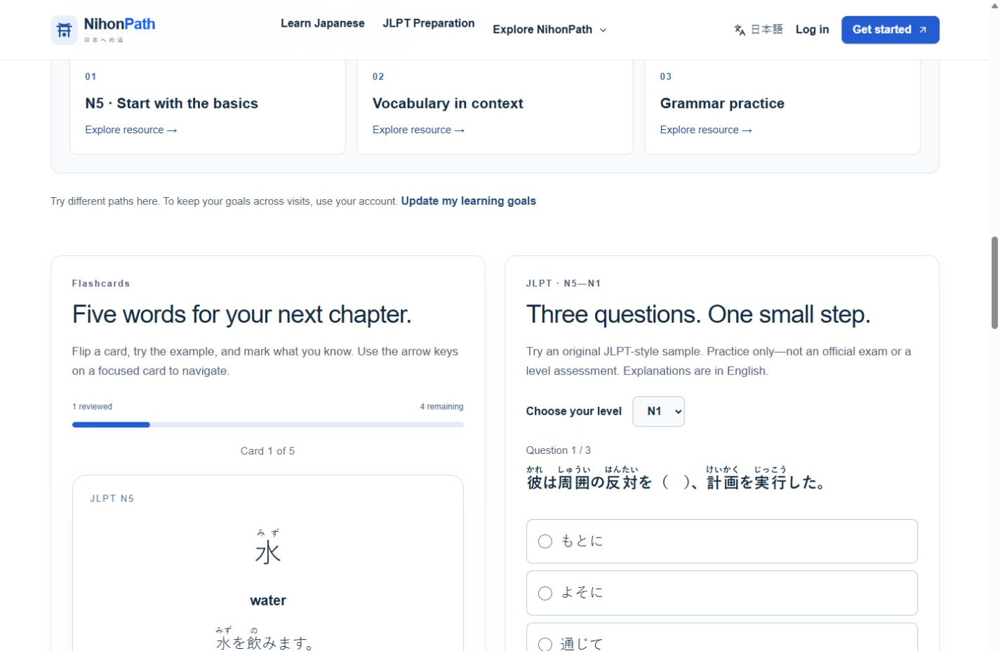
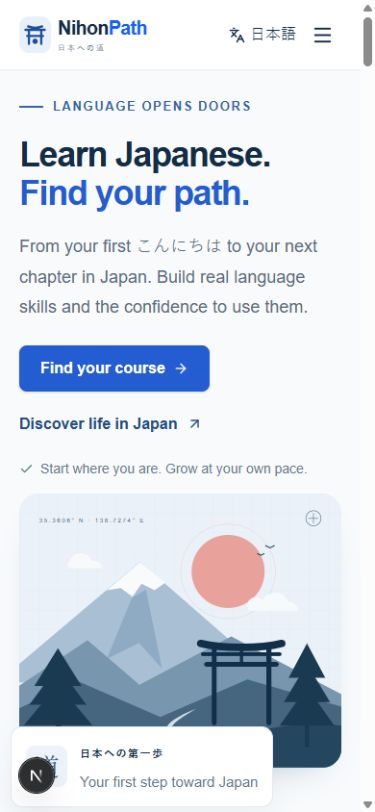

# NihonPath｜日本語学習プラットフォーム

NihonPath は、日本語学習者や日本での生活・就労を目指す人向けのポートフォリオプロジェクトです。JLPT N5〜N1 の学習導線と、JFT-Basic・特定技能（SSW）対策や日本での生活ガイドを一つのサイトにまとめています。

## 確認できる機能

- 日本語・英語・ネパール語・ヒンディー語の画面ルーティングと、モバイル対応のナビゲーション
- ログインなしで試せる単語カードと JLPT 形式の練習問題
- Supabase を設定すると利用できる認証、学習目標の設定、進捗の保存
- コンテンツ管理画面と、権限に応じた下書き・レビュー・公開のワークフロー。利用にはマイグレーションと管理者の設定が必要です

## 技術構成

Next.js App Router、React、TypeScript、Tailwind CSS、shadcn/ui ベースのコンポーネント、next-intl、Supabase Auth、PostgreSQL（Row Level Security）。検証には ESLint、Vitest、Playwright、PGlite を使用しています。

## 開発状況

私が企画した日本語学習・生活支援の構想をもとに、AI コーディング支援を活用して開発しています。認証・編集権限・データベースはローカルで検証済みです。本番環境での認証・メディア運用の確認、リスニング教材、外部サービス連携は今後の作業です。AI 会話の実サービスや決済は設定が必要で、決済はサンドボックス実装です。

## 画面例

開発中に撮影した公開画面です。

| デスクトップの練習画面 | モバイルのホーム画面 |
| --- | --- |
|  |  |

## ローカルで起動する

Node.js 24 と pnpm 11.25.0 が必要です。

```sh
pnpm install --frozen-lockfile
pnpm dev
```

[日本語ホーム](http://localhost:3000/ja) で、公開ページと練習サンプルを確認できます。認証・保存・管理画面を試す場合は、`.env.example` を `.env.local` にコピーして自分の開発用 Supabase プロジェクトの設定を入力し、[Supabase セットアップ](docs/SUPABASE_SETUP.md) に従ってください。

```sh
pnpm lint
pnpm typecheck
pnpm test
pnpm test:db
pnpm build
```

[アーキテクチャ](docs/ARCHITECTURE.md) · [管理画面と CMS](docs/TASK13_ADMIN_CMS.md) · [検証結果](docs/TASK13_VERIFICATION.md) · [公開準備と運用](docs/TASK12_LAUNCH_REPORT.md)
