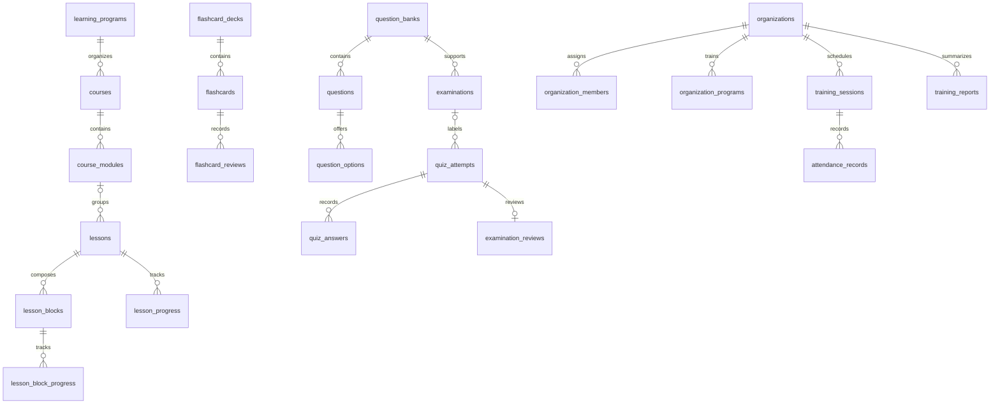

# Platform architecture

## Source organization

- `src/components/home/`: retained homepage and illustration.
- `src/components/layout/`: shared brand, expanded navigation, language switcher and footer.
- `src/components/platform/`: LearningCard, LessonModule, CourseProgress, FlashcardPreview, MockTestPreview, GoalSelector, Recommendations, DashboardNav, ContentEditor, NavigationDisclosure and LessonCompletion.
- `src/components/flashcards/`, `quiz/`, `learning/japanese.tsx`: existing interactive engines and ruby rendering, reused by previews and lessons.
- `src/lib/platform/`: category/goal taxonomy, recommendation rules, Zod editor contracts, typed schema additions, content references and server-only admin verification.
- `src/actions/`: account flows and existing learning actions, plus owner-derived goal saving, lesson completion and server-authorized editorial actions.
- `src/app/[locale]/`: existing routes extended with onboarding, account-goal editing, content studio, program/course readers and lesson readers.
- `messages/`: typed English/Japanese UI catalogs. `Platform` contains the new interface copy.
- `supabase/migrations/`: immutable historical migrations followed by the additive expansion.

Pages and data fetching remain Server Components. Only forms, previews, goal selection and interactive controls use client state. No service-role key is needed by the app.

## Learning relationships

A legacy lesson can still reference a course directly. New lessons may also reference a module; a composite foreign key requires the module to belong to that same course. Existing course IDs and level URLs are preserved. New arbitrary course slugs live under program URLs rather than changing the semantics of `/courses/n5`–`n1`.

Content translations have exactly one real foreign-key target (program, course, module, lesson or component) and a locale. Their review/publication state is independent; public reads require a published parent. Base content remains the fallback when no published translation exists. The reader supports localized program titles/summaries, course and module titles, and lesson/component text.

Lesson component JSON is versioned and rendered through explicit types (`text`, `example`, `flashcards`, `quiz`, `audio`), without `dangerouslySetInnerHTML`. Existing curated decks and N4 bank open the existing engines. Other custom quiz/deck players and audio playback are future adapters and display a clear coming-soon state.

## Preferences versus authority

`profiles.learning_goal` remains for backward compatibility with the existing single-goal form. Recommendations use `user_learning_goals` as their source. The migration backfills an initial goal for existing profiles without marking onboarding complete. New verified accounts are directed to onboarding; existing users can edit the same form in the dashboard.

`set_learning_goals` obtains the user ID from `auth.uid()` and atomically replaces the selected set. It cannot receive a target user ID or alter admin/organization memberships. `teacher` and `organization_admin` are interests, not roles.

Global content administrators remain in `private.admin_users`, assigned by the project owner. Every editor page and mutation checks a verified server user and `is_admin`; SQL RPCs independently repeat authorization. Learner-supplied publication flags are ignored by the save contract.

## Editorial workflow

1. Create or edit a draft.
2. Request review.
3. A trusted administrator approves the content.
4. Publish it after its parent/reference content is public.
5. Published records become visible on program and lesson routes through RLS.

Saving edits resets approval and unpublishes that record. This also hides its descendants from public readers until republished. Record timestamps provide optimistic concurrency; a stale editor cannot silently overwrite another editor. Review state transitions are logged in an immutable private audit table. This first version uses global trusted reviewers, not a separate two-person approval rule.

## Future boundaries

| Interface | Tables / relationships | Current implementation |
| --- | --- | --- |
| AI role-play | `ai_scenarios`, owner-scoped `ai_roleplay_sessions` | Model only; no provider or client session-write grant |
| Listening | `audio_assets`, `lesson_blocks.audio_asset_id` | Ready/public metadata contract; no player/upload pipeline |
| Tutors | `tutor_bookings` with learner/tutor identities | Participants can read; no client booking writes, payments or payouts |
| Institutes/employers | organizations, assigned members, program associations | Tenant RLS; no self-created organization roles |
| Attendance | training sessions and membership-scoped attendance records | SQL foundation; assigned staff writes only |
| Employer reports | organization-scoped training reports | SQL foundation; no invented reports or metrics |
| Visa information | checklist templates/items, source and review metadata | Informational contracts only; no eligibility judgments |
| Reviewed exams | examinations, existing attempts, private-admin reviewer assignment | SQL foundation; only released feedback readable by attempt owner |

## Scaling boundaries

The editor currently lists the most recent 100 items per type and uses the provider's reference-query limit. Add explicit pagination/search for large catalogs. The editor uses structured JSON textareas rather than a rich-text authoring suite. SQL foreign keys are authoritative; the manually maintained TS types should be regenerated from the deployed schema before introducing join-heavy APIs. Full historical revision storage, staged replacement of published versions, fine-grained reviewer roles and cross-organization analytics remain future work.
